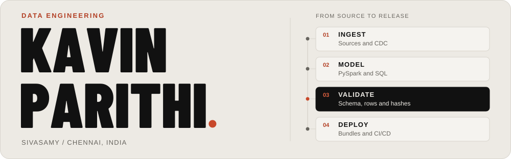

<picture>
  <source media="(prefers-color-scheme: dark) and (max-width: 600px)" srcset="./assets/header-mobile-dark.svg">
  <source media="(max-width: 600px)" srcset="./assets/header-mobile-light.svg">
  <source media="(prefers-color-scheme: dark)" srcset="./assets/header-dark.svg">
  
</picture>

I'm **Kavin Parithi Sivasamy**, a Data Engineer at **zeb**, based in Chennai. I build and modernise Azure Databricks pipelines with PySpark and SQL, from ingestion and data models to validation and deployment.

[**Explore my portfolio**](https://kavinparithi-works.github.io/portfolio/) &nbsp; / &nbsp; [LinkedIn](https://linkedin.com/in/kavinparithi) &nbsp; / &nbsp; [Email](mailto:kavinandhiswork@gmail.com)

**On record:** [Databricks Certified Data Engineer Professional](https://credentials.databricks.com/ce44e03b-f894-42e1-94a0-fcbdec372be2#acc.DEFdqP64)

## The work behind the pipelines

My professional work includes SAP-to-lakehouse pipelines, legacy migrations and shared Databricks utilities. One ongoing engagement replaces shared control-table dependencies with self-describing notebooks, checking SQL, schemas and hashes as each report bundle moves through environments.

**[Read the engineering case studies](https://kavinparithi-works.github.io/portfolio/#work)** for the problems, implementation choices and outcomes. Client engagements are described anonymously; the public builds below have source code to explore.

## Selected public builds

### 01 / [Portfolio](https://github.com/kavinparithi-works/portfolio)

The design and implementation of my personal site: interactive case studies, an illustrated portrait and layouts tailored to phones and larger screens. Content is pre-rendered, with lint, component tests and a production build before deployment.

`React` · `Vite` · `Tailwind CSS` · `GitHub Pages`

[Visit the site](https://kavinparithi-works.github.io/portfolio/) &nbsp; / &nbsp; [Explore the case-study components](https://github.com/kavinparithi-works/portfolio/tree/main/src/components/sections/Work)

### 02 / [Hospital waste workflows](https://github.com/kavinparithi-works/Hospital-biomedical-waste-management)

A full-stack demo for logging waste, assigning collections and reviewing audit records. Admin, staff and worker flows share one API. The waste assistant combines browser-based text classification with optional Gemini image classification.

`React` · `Express` · `MongoDB`

[Explore the role-based UI](https://github.com/kavinparithi-works/Hospital-biomedical-waste-management/tree/main/hospital-waste-frontend/src/pages) &nbsp; / &nbsp; [Setup and architecture](https://github.com/kavinparithi-works/Hospital-biomedical-waste-management#readme)

### 03 / [Learn DE](https://github.com/kavinparithi-works/learn-DE)

A data engineering study app covering SQL, Python, Spark, Delta Lake, Azure and Airflow. It brings lessons, code examples and quizzes together, with Firebase-backed sign-in and progress tracking.

`React` · `TypeScript` · `Firebase`

[Try the learning app](https://kavinparithi-works.github.io/learn-DE/) &nbsp; / &nbsp; [Explore the lesson pages](https://github.com/kavinparithi-works/learn-DE/tree/main/src/pages)

## My working stack

  
  
  
  
  
  

**Build:** PySpark, SQL, Delta Lake, batch and streaming ingestion, medallion models.  
**Check:** schema enforcement, reconciliation, data-quality pipelines and SQL alerts.  
**Ship:** Unity Catalog, Databricks Asset Bundles and Azure DevOps across Dev, QA and Prod.

## How I work

I sketch the architecture before writing the pipeline. Validation and reconciliation are part of the build. I write the release guides and decision notes too, so the next engineer has something useful to work with.

---

**Have a data engineering problem to work through?**  
[kavinandhiswork@gmail.com](mailto:kavinandhiswork@gmail.com) &nbsp; / &nbsp; [Connect on LinkedIn](https://linkedin.com/in/kavinparithi)
